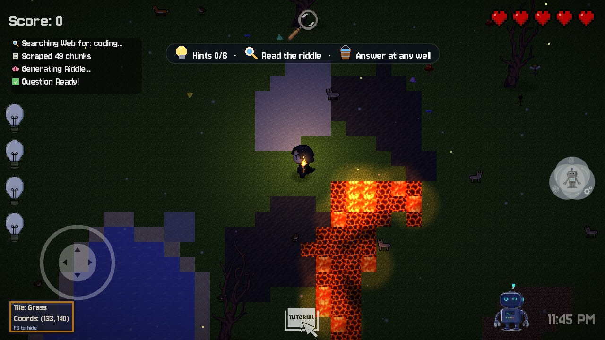
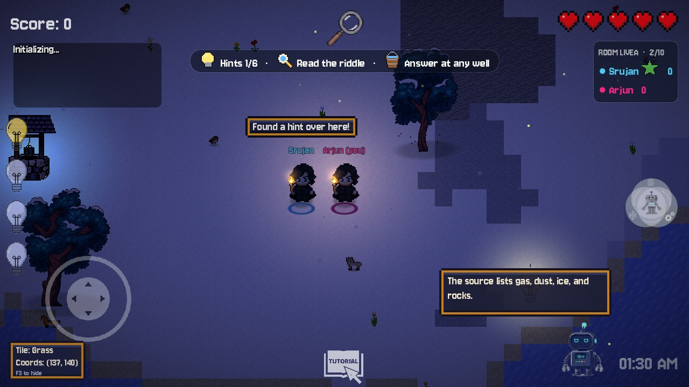
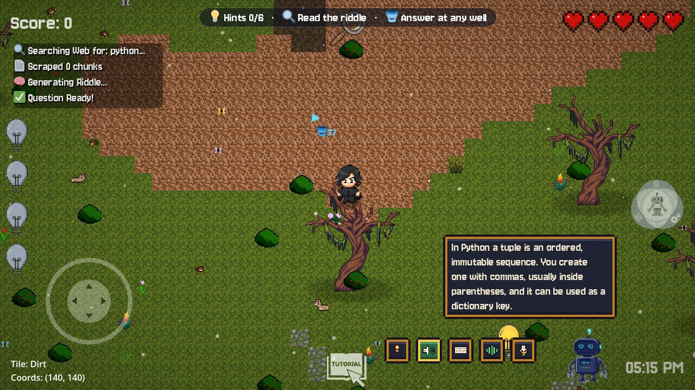

# Endless Worlds

**Type any topic. Get a living pixel island, a riddle written from the live web, a robot guide you
can talk to, and up to 9 friends to race to the answer.**

Endless Worlds is an educational 2D exploration game built in **Godot 4.5**. A Python AI server turns
any topic into a validated riddle with hints (web search → RAG → Groq LLM). A Q-learning agent
adapts the difficulty to each player, and a free Cloudflare relay connects players into
10-player online rooms.



| | |
|---|---|
|  |  |
| **Online rooms:** same island, shared hints, chat, live scores | **Bolt:** voice companion that nudges, never spoils |

## Documents

| | |
|---|---|
| [docs/USER_GUIDE.md](docs/USER_GUIDE.md) | How to install and play (solo, online, Bolt, controls, troubleshooting) |
| [docs/Endless-Worlds-Pitch-Deck.pdf](docs/Endless-Worlds-Pitch-Deck.pdf) | 15-slide deck: why the game is better, with architecture, pipelines and before/after |
| [docs/Multiplayer-How-It-Works.pdf](docs/Multiplayer-How-It-Works.pdf) | 10-page visual and technical walkthrough of multiplayer |
| [relay/README.md](relay/README.md) | Cloudflare developer guide: run, deploy for free, protocol, limits |
| [python_server/ARCHITECTURE.md](python_server/ARCHITECTURE.md) | AI server pipelines and endpoints |
| [docs/INTERVIEW_PREP.md](docs/INTERVIEW_PREP.md) | Interview prep guide for explaining the project (written for the v1 single-player architecture) |

The PDFs are generated from `docs/src/*.html`; see *Rebuild the PDFs* below.

## Features

**Learning**
- Any topic → riddle grounded in a scraped web page (DuckDuckGo → Bing → Brave fallback), FAISS per-topic cache, Groq `gpt-oss-120b`
- Every LLM answer is **validated** (one word, ≤ 12 chars, present in the options, 4 hints) with one retry
- **Offline bank** of 38 topic-tagged riddles, so the game never hangs when the server is down
- Six answer formats: MCQ, fill-in, Wordle, whack-a-answer, word lock, quiz show with lifelines, plus 50 coding quests
- **Q-learning difficulty** (5 levels), win streak bonus, Learning Journal of solved riddles and facts

**Bolt, the voice companion**
- Push-to-talk (**V**), hands-free voice-activity detection, or typing
- Whisper speech-to-text (`/api/transcribe`), spoiler-free RAG answers (`/api/rag`), OS/browser text-to-speech
- Click Bolt for a pixel-icon tray: talk · hands-free · type · voice · torch · chat

**World**
- Procedural islands in four biomes, day/night, rain and real drifting snow
- Wildlife: sparrows fly off, rabbits, deer and foxes run away, frogs hop at the shore when any player comes close; flocks of birds cross the sky; butterflies, fireflies and flies
- Real lighting: CanvasModulate night with a hand-held torch (auto at night / **F**), glowing wells, hints and lava; bloom, vignette, per-biome grade
- 6 playable characters (pick with the arrows on the home screen)
- Pixel-art water: dithered shallow → deep shading, lapping shoreline foam, glints; wade in the shallows, swim with momentum in deep water (splashes, ripples, air bubbles)
- Daylight cycle (~6.5 min): sunrise colours, sun shadows that follow the sun, sunbeams; night with torch, lava and well light that reaches every object
- Jump (**Space**) with squash-and-stretch and landing dust; hop over small lava patches
- Objective bar + faint compass arrows to the nearest hint and well; F3 tile/coords panel; pause menu (**Esc**)
- Pixel-art icon font: every emoji in the UI renders as a matching 16 px pixel icon

**Phones & web** (GitHub Pages build)
- Portrait and landscape: the UI scale is picked from the phone's screen size, popups shrink to fit, and the home screen re-flows when you rotate or the keyboard opens
- Touch controls: joystick, jump (**↑**), **Answer** at wells, **II** pause/home, survival **DASH** with auto-aim; tap lit bulbs to read hints
- Own on-screen keyboard for every text box (letters, symbols, emoji, a code row for the coding editor) instead of the phone's; big in-game keyboard for Wordle / fill-in answers
- Bundled emoji + symbol fonts, so emoji and ● ✓ → render in the browser too (no system fonts there)
- Auto fullscreen on phones, Fullscreen button, and an **Install app** button (`web/manifest.webmanifest`)

**Quality of life**
- ⚙ Settings (graphics quality, sound volume, vibration, fullscreen, install), daily visit streak with coin bonus, 18 achievements, "New riddle" in the pause menu
- CI play-through (`tools/smoke_test.gd`, `.github/workflows/smoke.yml`): every screen, answer type, weapon, mob and boss plus two-player online sessions run in headless Godot on every branch push

**Survival mode** (hidden: the small 🐛 button on the Stats page)
- A separate arcade game, pure GDScript (no AI server), on a random island (coastline, ponds, lava; walkers can't swim, flyers can)
- 12 mob types with their own AI (chasers, multi-coloured splitting slimes, erratic bats, ramming flying eyes, skeleton archers, lunging spiders, stinger-firing hornets, wolf packs, phasing ghosts, bombers, teleporting mages, golems) plus random mutations
- A boss ends every round: 12 named bosses, then endless generated ones; telegraphed slams and charges (red zones)
- 6 weapons (bolt, scatter wand, flame staff, star spear, moon boomerang, storm rod), bought and levelled to ★5 with coins in the Armory, saved between runs; perks after each boss; crits
- PC: mouse aim + reticle, Q/E or wheel to switch; phones: twin-stick (left move, right drag to aim, auto-aim when idle)
- Co-op over the relay (👥 Co-op): host-authoritative monsters streamed at 10 Hz, batched monster shots simulated on every client, guests report hits; per-player coins/weapons/perks; ghosts revive next round
- Day/night cycle with hand torch, glowing lava and light shafts (night: faster spawns, +50% coins); power-up drops (rage, shield, magnet, bomb); radar
- Sprites: `tools/make_mobs.py`; test flags `--surv-round=N --surv-bot --surv-god --surv-boss-now`

**Multiplayer** (details in the PDF)
- Room codes and invite links (`?room=CODE` joins directly), up to 10 players, coloured name tags, chat bubbles, live scoreboard; everyone keeps their chosen character
- The host is the authority: one seed → identical worlds; the host's riddle and hints are shared; first correct answer wins
- Guests' voice questions are answered by the **host's** AI server through the relay, so guests need no Python
- Relay: Cloudflare Worker + Durable Object on the **free plan**, deployed at `wss://endless-worlds-relay.srujanmpadmashali.workers.dev`

## Quick start

### Players
Unzip `EndlessWorlds-Windows.zip` → run `EndlessWorlds.exe`. See the [user guide](docs/USER_GUIDE.md).

### Developers
1. Install **Godot 4.5.1** and open `project.godot`.
2. Copy `.env.example` to `.env` and add your free Groq key (`GROQ_API_KEY`, used only by the AI server).
3. AI server: `python_server\start_server.bat` (Windows) or `python_server/start_server.sh`.
4. Press **F5** in Godot.

## Package for players

```powershell
powershell -ExecutionPolicy Bypass -File tools\package.ps1 -Godot "C:\path\to\Godot_v4.5.1-stable_win64_console.exe"
```

Needs the Godot 4.5.1 export templates (*Editor → Manage Export Templates*). It produces:

| Output | For |
|---|---|
| `build/EndlessWorlds-Windows.zip` | everyone: one .exe with `.env` baked in, plus `PLAY.txt` |
| `build/EndlessWorlds-AI-Server.zip` | the host: Python server + `.env` + `start_server.bat` |
| `build/web/` | GitHub Pages / itch.io (single-threaded export, no special headers needed) |

> The game build gets a filtered `.env` with only `RELAY_URL` / `API_URL`; the game never needs API keys.
> The AI-server zip includes your `.env` keys for private sharing; add `-Public` to ship `.env.example`
> instead (used for GitHub releases).

## Hosting (all free tiers)

| Part | Where | How |
|---|---|---|
| Multiplayer relay | Cloudflare Workers Free | `cd relay && npx wrangler login && npm run deploy`: [guide](relay/README.md) |
| Web build | GitHub Pages | push to `main`; `.github/workflows/godot-ci.yml` exports and deploys (Settings → Pages → Source: GitHub Actions) |
| AI server (optional, shared) | Hugging Face Spaces (Docker, free CPU) / Render / Railway | `python_server/Dockerfile`; set `GROQ_API_KEY` as a secret, then `API_URL` in `.env` |
| Windows builds | GitHub Actions artifact | same workflow; or `tools/package.ps1` locally |

CI needs no API keys. Optional secrets `CLOUDFLARE_API_TOKEN` + `CLOUDFLARE_ACCOUNT_ID` auto-deploy the
relay; optional repo variables `RELAY_URL`, `API_URL` point the builds elsewhere.

## Project layout

```text
core/            Global (save, stats, URLs, icon font), Net (multiplayer client), env loader
map_components/  world generator, time/weather, wildlife, atmosphere + hand torch, multiplayer sync
player/          movement, footsteps, camera
ai/              question generator + offline bank, Q-learning difficulty, Bolt + voice assistant
ui/              home, lobby, answer popups, coding, journal, HUD (guide, round card), pixel icons
data/            riddles.json (offline bank), coding_questions.json
python_server/   FastAPI AI server (scrape, RAG, riddles, Whisper, code checks), Dockerfile, tests
relay/           Cloudflare Worker relay + integration test
tools/           package.ps1
docs/            user guide, PDFs, their HTML sources and screenshots
```

## Tests

```bash
python python_server/tests/test_normalize.py            # riddle validator (4 tests)
cd relay && npm run dev   # then in another terminal:
cd relay && npm test                                     # relay protocol (local)
RELAY=wss://endless-worlds-relay.srujanmpadmashali.workers.dev npm test   # live relay
```

**Dev flags** for scripted runs and screenshots (after `--` on the Godot command line):
`--hour=22` `--biome=0..3` `--host-room=CODE --players=2` `--join-room=CODE` `--name=Ann`
`--topic=space` `--sim-hint-at=6` `--sim-win-at=15` `--sim-chat-at=10` `--sim-menu-at=3`
`--sim-voice=question.wav` `--lobby=1`.
Combine them with Godot's movie writer to record frames:
`godot --path . --write-movie out/f.png --fixed-fps 10 --quit-after 200 -- --host-room=TEST1`.

## Rebuild the PDFs

```powershell
& "C:\Program Files (x86)\Microsoft\Edge\Application\msedge.exe" --headless=new --no-pdf-header-footer `
  --print-to-pdf="$PWD\docs\Multiplayer-How-It-Works.pdf" "file:///$PWD/docs/src/multiplayer.html"
```
(The same command with `deck.html` → `Endless-Worlds-Pitch-Deck.pdf`.)

## Known limits

- If the host quits, the room ends (no host migration yet).
- Voice and live riddles need the AI server; the offline bank covers riddles only.
- The web build calls the AI server at `API_URL`; browsers need it on `https` (or `http://127.0.0.1`).
