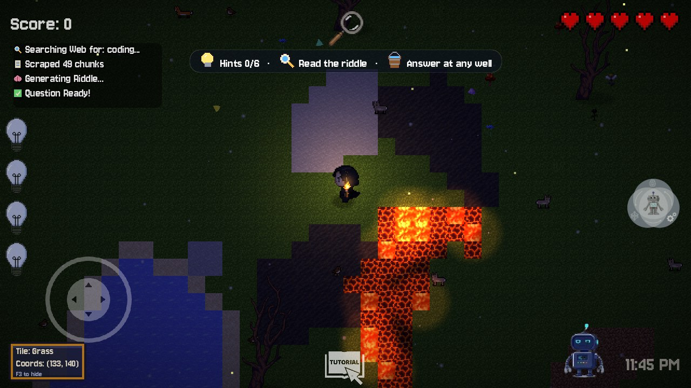

# Endless Worlds: player guide

## Install

**Windows:** unzip `EndlessWorlds-Windows.zip` and double-click `EndlessWorlds.exe`.
If Windows SmartScreen says *"unknown publisher"*, click **More info → Run anyway** (the game
isn't code-signed).

**Browser:** open the web link if your group published one (GitHub Pages / itch.io).

**AI server (optional, host only):** unzip `EndlessWorlds-AI-Server.zip` and run
`python_server\start_server.bat`. It needs [Python 3.10+](https://python.org) with "Add to PATH"
ticked. The first start installs packages, which takes a few minutes. Keep the window open while
you play.
Without it, the game uses its built-in question bank, and everything except live web riddles and
voice still works.

## Play solo

1. Pick your character with the **<** **>** arrows, type any topic or tap a chip
   (*Python, Space, Biology…*), then press **START**.
2. A new island appears. The bar at the top tells you what to do next.
3. Click the **magnifier** at the top to read the riddle.
4. Follow the **gold arrow** to hint bulbs. Each one lights a bulb on the left; hover it to read the hint.
5. Follow the **blue arrow** to any **well** and walk into it to answer.
6. Correct answer → **Level cleared!** → *Next level* (a bit harder) or *Home* (opens your Learning Journal).

The home screen shows whether the AI is **online** or the game is in **offline mode**, your
current AI-chosen difficulty and your win streak.

### Answer formats
You'll get one of these at the well: multiple choice, fill in the blank, Wordle, whack-a-answer,
word lock, or the quiz show with 50:50, audience poll and phone-a-friend.
**Coding** (top right on the home screen) gives you programming quests instead.

### Water
Next to the shore the water is shallow: you wade (a bit slower) and can still jump.
Further out it gets deep: you swim, drift with momentum, and your air bubbles start counting down.

### Dangers
- **Lava / magma:** lose a heart every 2 s.
- **Water:** you sink and slow down; bubbles show your air. When they run out, you take damage.
- **Wrong answers:** cost hearts. At 0 hearts the run ends (solo) or you respawn (online).

## Bolt, your robot guide

Bolt sits in the bottom-right corner. **Click him** to open his tray:

| Icon | Does |
|---|---|
|  Talk | Speak a question (or hold **V** anywhere) |
|  Hands-free | Just start talking; Bolt hears you when you speak |
|  Type | Type a question instead |
|  Voice | Turn Bolt's spoken replies on/off |
|  Torch | Auto (night only) → On → Off (or press **F**) |
|  Chat | Message your room (online only, or press **T**) |

Bolt explains concepts and gives nudges, but **he will never say the answer**. He also reads
each hint aloud when you pick up a bulb. Voice needs the AI server (on your PC, or on the host's
PC when you play online).

## Play together (up to 10)

**Host**
1. *(Optional)* start the AI server for live riddles and voice for everyone.
2. **Multiplayer → your name → Create room.** The 5-letter code is copied to your clipboard.
3. Send the code to your friends and press **Start** when everyone is listed.

**Friends**
1. **Multiplayer → your name → type the code → Join.**
2. Wait for the host to press Start.

Everyone gets the **same island and the same riddle**. Hint bulbs are shared: when anyone grabs
one, it lights up for the whole team. The **first correct answer wins the round**, and then a new
island loads for everyone automatically. Each player has a name tag in their colour and the character they picked; the
scoreboard is at the top right.

Want the details? See [Multiplayer-How-It-Works.pdf](Multiplayer-How-It-Works.pdf).

- **Topic:** the host types or picks the topic in the room (everyone sees it change). During a game the
  host can open pause → **Topic** to start a new round on a different topic. Without the AI server the
  riddle comes from the built-in question bank.
- **Find your friends:** small arrows in each player's colour circle around you and point to where they are.

## Controls

| Action | Keyboard / mouse | Gamepad / touch |
|---|---|---|
| Move | WASD / arrow keys | left stick / on-screen joystick |
| Sprint | Shift (or middle mouse) | push the joystick all the way |
| Jump | **Space** (clears small lava patches) | A button / **↑** button |
| Answer at a well | walk in, or **E** / Enter | walk in, or the **Answer** button |
| Read riddle | click the magnifier | tap |
| Read a hint | hover a lit bulb | tap a lit bulb |
| Talk to Bolt | hold **V**, or click Bolt → mic | tap Bolt |
| Torch | **F** | Bolt → torch |
| Chat (online) | **T**, Enter to send | Bolt → chat |
| Tile / coords panel | **F3** (shown by default) | hidden on phones |
| Pause / Home | **Esc** or the **II** button | **II** button (top-left) |
| Fullscreen | pause menu or home screen | pause menu or home screen |

### Phones and tablets (web build)

- Works in portrait and landscape; the screen re-fits when you rotate.
- Tap any text box (topic, name, room code, chat, Bolt, code editor) and the game's own keyboard
  slides up: letters, numbers, symbols (`#+=`), an emoji page (😀), and a code row ( ⇥ ( ) [ ] { } : = ← → )
  in the coding editor. Hold ⌫ to delete quickly; ⌄ closes it. The phone's keyboard is not used.
- **Fullscreen:** turns on by itself at your first tap (Android, iPad). *Exit fullscreen* on the home
  screen or in the pause menu turns it off (and stops it coming back).
- **Install it like an app:** the **📲 Install app** button on the home screen (Android Chrome shows
  the install prompt; on iPhone it shows how: Share → *Add to Home Screen*). It then opens
  fullscreen with its own icon.

## Survival mode (secret)

Open **Stats** and press the small **🐛** button next to the close button.

- Every run is a new **island**: beaches, ponds, lava pools and trees. Walkers can't cross water;
  bats, eyes, hornets and ghosts fly over it.
- Waves of monsters climb out of purple portals: zombies, slimes in many colours, bats, flying eyes,
  skeleton archers, spiders, hornets, wolf packs, ghosts, bombers, mages and golems. Some are
  **mutated** (Swift, Giant, Explosive, Vampiric…).
- Clear a wave and a **boss** arrives (Slime King, The Watcher, Bone Lord, Hive Queen… then endless
  generated ones). Red zones on the ground show where a slam or charge will land: step out of them.
- After each boss: pick a **perk** (damage, fire rate, multishot, crits, max heart…), then visit the
  **🛒 Armory**.
- Monsters drop **🪙 coins**. In the Armory buy new weapons and level them up to ★5. Coins and weapons
  are **saved between runs**.

| Weapon | |
|---|---|
| ✦ Arcane Bolt | quick bolts, any range (you start with it) |
| ✸ Scatter Wand | shotgun burst, huge up close |
| 🔥 Flame Staff | exploding fireballs for groups |
| ➶ Star Spear | very fast, pierces several enemies |
| ☾ Moon Boomerang | flies out and back, hits twice |
| ⚡ Storm Rod | lightning that chains between enemies |

| Action | PC | Phone |
|---|---|---|
| Aim + shoot | mouse, hold left button (or **J**) | drag on the right half of the screen; let go to auto-aim |
| Switch weapon | **Q / E**, **1-6**, mouse wheel | **⇄** button |
| Dash (brief invulnerability) | right mouse or **K** | **DASH** |
| Move / sprint / jump | WASD / Shift / Space | left joystick (push far to sprint) / **↑** |
| Pause | Esc | **II** |

Your best round and score appear on the Stats page.

## Troubleshooting

| Problem | Fix |
|---|---|
| Home says **Offline mode** | Start `start_server.bat` and keep it open; reopen the home screen. |
| *"Can't reach the multiplayer relay"* | Check your internet; school or office networks sometimes block WebSockets. |
| *"Room not found"* | The host must create the room first. Check the 5 letters. |
| Bolt says he can't reach his brain | The AI server isn't running (on the host's PC when online). |
| Bolt doesn't hear you | Allow microphone access for the game (Windows: Settings → Privacy → Microphone). |
| Progress reset | Saves live in `%APPDATA%\Godot\app_userdata\endless-worlds\`. |
